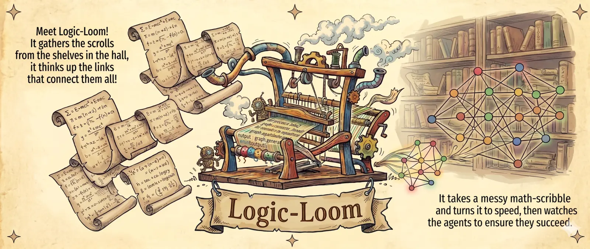

# Logic-Loom

{ .hero-banner }

Logic-Loom is a desktop app for research workflows. It turns a Zotero library into a
searchable Obsidian vault with [zotero-summarizer](https://github.com/CEmM2/zotero-summarizer),
and adds optional knowledge-graph tooling from [AKMS](https://cemm2.github.io/AKMS/),
paper discovery, a computational-mechanics compiler from
[MechDSL](https://cemm2.github.io/MechDSL/), and read-only views of agent memory.

It is a Tauri desktop shell (Rust + React) that starts a local Python API, the
`logic-loom-api` sidecar, and talks to it over a random local port. Nothing leaves
your machine unless you configure a cloud LLM provider.

## Six modes

Every workflow belongs to one of six modes, picked from the top bar.

| Mode | What it is for | Needs |
| --- | --- | --- |
| [zsum](guide/zsum.md) | Run the zotero-summarizer pipeline and browse the published vault | Core install |
| [AKMS](guide/akms.md) | Batch node generation, node review, the read-only graph explorer, Learn | `akms` extra |
| [Assistant](guide/assistant.md) | Paper discovery, source batches, workflow runs, workspace search | Core install |
| [MechDSL](guide/mechdsl.md) | Compile `% mechanics` LaTeX into FEM solver code | `mechdsl` extra |
| [Failure Memory](guide/failure-memory.md) | Inspect `.failure-memory` lesson registries; opt-in operator mode | `failure-memory` extra + configured projects |
| [Records](guide/records.md) | Browse akms-records stores and their record graph | `records` extra + configured stores |

Release builds include every extra. When a mode's requirements are missing, its tabs
show a setup message instead of failing.

## Where to start

- **Using the app:** [Install](install/index.md), then [First run](install/first-run.md).
- **Configuring it:** [Configuration](install/configuration.md) and
  [LLM providers](install/llm-providers.md).
- **Working on the code:** [Developer setup](developers/index.md) and
  [Architecture](developers/architecture.md).
- **What changed:** [Changelog](changelog.md) and the
  [GitHub Releases](https://github.com/CEmM2/Logic-Loom/releases).
